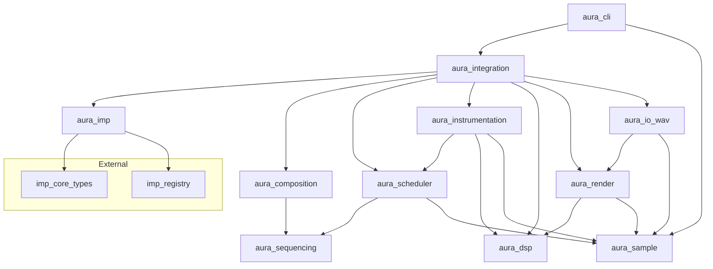

# Aura Engine

Procedural music composition and synthesis software (Rust).

This repository is the **engine** product (`aura-engine`). Multi-repo Docker Compose orchestration lives in **aura-workbench**.

## Status

Early / pre-alpha. Multi-crate workspace with Imp graph-driven offline WAV rendering.

## Language

Rust (primary).

## Quick start

From the repo root:

```bash
cargo build
cargo test
cargo clippy
./demos/render-all.sh
```

This renders `demos/demo-01.json` and `demos/demo-02.json` to `output/demo-01.wav` and `output/demo-02.wav` (32-bit float, mono, 44100 Hz). Demo-01 builds the arpeggio procedurally; demo-02 loads the same cycle from sibling `demos/demo-02-arpeggio.json` via `notation_score`. The `output/` directory is gitignored.

### CLI

```bash
cargo run -p aura_cli -- \
  --graph demos/demo-01.json \
  --output output/demo-01.wav \
  --duration 2m \
  --tempo 120 \
  --sample-rate 44100
```

```
aura --graph PATH --output PATH [OPTIONS]

  -g, --graph PATH         Imp graph JSON file
  -o, --output PATH        Output WAV path
  -d, --duration SPEC      Seconds (10, 10s) or measures (2m)
  --tempo BPM              Tempo for measure durations (default: 120)
  -r, --sample-rate HZ     Sample rate (default: 44100)
  -h, --help               Show help
```

## Workspace crates

| Crate | Purpose |
|-------|---------|
| `aura_sample` | DASP sample primitives and timing types |
| `aura_sequencing` | Notation types and musical time |
| `aura_composition` | Procedural composition generators |
| `aura_scheduler` | Offline event scheduling |
| `aura_instrumentation` | Per-note instruments and mix-down |
| `aura_imp` | Imp node libraries and JSON helpers |
| `aura_dsp` | Pure Time → Sample DSP functions |
| `aura_render` | Offline sampling via `Sampler` |
| `aura_io_wav` | WAV file I/O |
| `aura_io_cpal` | CPAL playback stub (deferred) |
| `aura_integration` | Imp graph translation and render glue |
| `aura_cli` | Thin graph-driven CLI |

## Dependency graph



## Documentation

- [`docs/`](docs/) — scoping (motivation) and design (declarative requirements), including per-crate docs
- [`AGENTS.md`](AGENTS.md) — agent workflow and conventions

## License

MIT — see [LICENSE](LICENSE). Copyright (c) 2026 Silent Orb.
