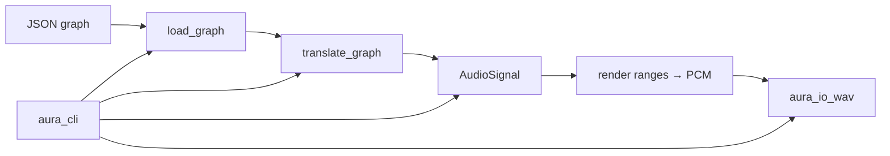

# Architecture

Declarative system requirements for Aura’s crate layout and data flow.

Aura is a **library-first framework**. Surface programs load Imp graphs and render audio via [`aura_integration`](../../crates/aura_integration). See [`notation-synthesis.md`](notation-synthesis.md) and [`imp-execution.md`](imp-execution.md). Motivation: [`../scoping/background.md`](../scoping/background.md).

This repository is **aura-engine**. Day-to-day development attaches through **aura-workbench**, which mounts this tree and Imp path deps; orchestration does not live in this repo.

## High-level components

| Component | Role |
|-----------|------|
| Sequencing | Notation types and musical time (`aura_sequencing`) |
| Composition | Procedural generators (`aura_composition`) |
| Scheduler | Offline timeline and event dispatch (`aura_scheduler`) |
| Synthesizer | Imp node libraries (`aura_imp`) and pure DSP (`aura_dsp`) |
| Integration | Graph translation for deterministic and streaming modes, and rendering (`aura_integration`) |
| Instrumentation | Per-note sampling and mix-down (`aura_instrumentation`) |
| Rendering | Block signals (`Signal`, `StereoSignal`), shared outputs, sinks; streaming voices and mixing (`aura_render`) |
| I/O | Offline WAV export (`aura_io_wav`); CPAL transport and streaming outputs (`aura_io_cpal`) |
| Plugin hosting | Third-party plugins as nodes: protocol-neutral seam (`aura_plugin_host`), CLAP backend (`aura_clap`); see [`plugin-hosting.md`](plugin-hosting.md) |

## Crate layout

Organize Rust source as a Cargo workspace of small crates under `crates/`. New features land in the smallest crate that owns the concern. Crate boundaries enforce explicit `Cargo.toml` dependencies; cross-crate APIs are deliberate.

| Crate | Role | Key dependencies |
|-------|------|------------------|
| [`aura_sample`](../../crates/aura_sample) | Sample primitives, sample rate, timing math | DASP |
| [`aura_sequencing`](../../crates/aura_sequencing) | Notation types, musical time | thiserror |
| [`aura_composition`](../../crates/aura_composition) | Procedural generators | aura_sequencing |
| [`aura_scheduler`](../../crates/aura_scheduler) | Offline schedule, lookahead context | aura_sequencing, aura_sample |
| [`aura_instrumentation`](../../crates/aura_instrumentation) | Instruments, per-note render, mix-down | aura_scheduler, aura_dsp, aura_sample |
| [`aura_imp`](../../crates/aura_imp) | Imp node libraries and JSON helpers | imp_core_types, imp_registry |
| [`aura_dsp`](../../crates/aura_dsp) | Per-frame DSP functions of time | — |
| [`aura_render`](../../crates/aura_render) | Block signals and their adapters; `Renderer` and offline rendering; streaming voices, mixer, `BlockSource` | aura_dsp, aura_sample, aura_sequencing |
| [`aura_plugin_host`](../../crates/aura_plugin_host) | Plugin seam (`Processor`, `PluginResolver`); deterministic `RenderCache`; streaming `PluginStage` | aura_render, aura_sample, aura_sequencing |
| [`aura_clap`](../../crates/aura_clap) | CLAP backend: discovery, loading, shared CLAP main thread, processing | aura_plugin_host, clack-host |
| [`aura_io_wav`](../../crates/aura_io_wav) | 32-bit float WAV write/read verification | aura_render, aura_sample |
| [`aura_io_cpal`](../../crates/aura_io_cpal) | Real-time output: `PlaybackEngine` (deterministic transport) and `StreamingOutput` (streaming) | CPAL, DASP, aura_render |
| [`aura_integration`](../../crates/aura_integration) | Imp graph translation (incl. plugin nodes), render glue, thin Miro host helpers | aura_imp, composition stack, render, aura_plugin_host, io-wav, `imp_mir` |
| [`aura_cli`](../../crates/aura_cli) | Thin graph-driven CLI (+ `sync`) | aura_integration |

Mir sync fabric is **`imp_mir`** (hosted in tome-rust-server), not an Aura crate. See [`miro.md`](miro.md).

Dependency direction flows inward: surface programs → integration → I/O → render → domain crates → sample / dsp → imp.

Per-crate design: [`../crates/`](../crates/).

### Surface integration

An indirect dependency is a hidden direct dependency. Orchestration lives in `aura_integration` and thin surface programs (`aura_cli`, demo scripts), not inside core libraries.

## Audio stack roles

| Library / crate | Role |
|-----------------|------|
| **DASP** (`dasp_sample`, `dasp_signal`) | Sample type traits and signal abstractions; bridges PCM to CPAL formats |
| **CPAL** | Cross-platform real-time audio I/O (device may be absent under workbench/WSL) |
| **`aura_dsp`** | Per-frame DSP functions of time |
| **`aura_io_wav`** | Offline 32-bit float WAV I/O |
| **`clack-host`** | CLAP hosting (via `aura_clap`); plugins run in-process |

Both playback modes share the same runtime form — block signals rendering ranges of frames, each node output built once and shared — and the same node implementations, except where a node type supplies a streaming implementation ([`imp-execution.md`](imp-execution.md), [`playback-modes.md`](playback-modes.md)). Deterministic node state is nonessential; streaming node state may carry history. Plugin nodes are the bounded exception: a plugin renders forward from frame 0 into a retained cache that answers any range ([`plugin-hosting.md`](plugin-hosting.md)).

## Data flow

### Imp graph → offline WAV

### Notation in Imp graphs

Music nodes (`arpeggio`, `epic_minor_progression`, `note_at_time`, …) delegate to composition crates at **translate time**. Render-time evaluation uses precomputed schedule tables — timing remains explicit via the `time` signal. Chord progressions are **data signals** (`chord_progression` port type) composed at translate time and read per frame via `ChordSignal`. Tempo and time signature are separate **data signals** (`tempo`, `time_signature` port types) wired between producer nodes (`constant_tempo`, `constant_time_signature`) and consumers.

### Audio layouts

Audio is mono (`audio_mono`) or stereo (`audio_stereo`). Most DSP node types are generic over `A: Audio`, so the input layout decides the output layout and Imp rejects mismatched inputs; converters (`pan`, `stereo_to_mono`, `stereo_join`, `stereo_split`) mix layouts explicitly. Translation yields an `AudioSignal`, and the output layout decides WAV channels and device mapping. See [`audio-layouts.md`](audio-layouts.md).

### Real-time playback

Transport playback is deterministic: `aura_io_cpal::PlaybackEngine` renders the same frames as offline rendering (mono or stereo) from a start frame until stopped. One render thread keeps a ring buffer 2 s ahead of the playhead, filled before the device opens, so the audio callback only copies ([`plugin-hosting.md`](plugin-hosting.md#transport-playback-render-ahead)). Live note audition is streaming: `StreamingOutput` pulls blocks from a `VoiceMixer` whose voices are per-note instances of a voice graph translated for streaming mode. Missing devices return a clear error. See [`playback-modes.md`](playback-modes.md).

## Constraints

- **Real-time audio** — API available; device may be absent in WSL/devcontainer; file-first WAV remains the primary automated validation path
- **Determinism** — any range renders identically (deterministic node state is nonessential); see [`imp-execution.md`](imp-execution.md) and [`notation-synthesis.md`](notation-synthesis.md)
- **Modularity** — composition, scheduling, instrumentation, and synthesis are separable via crate boundaries

## Non-goals / avoided approaches

- A single monolithic crate for all Aura domains
- History-carrying (`tick`-style) node state in deterministic mode; it belongs in streaming implementations
- Streaming as the primary playback model (it degrades from deterministic; see [`playback-modes.md`](playback-modes.md))
- Hiding surface orchestration behind transitive core-crate dependencies

## Open questions

- Graph-owned duration vs external render parameters
- How far streaming fallbacks should approximate deterministic look-ahead
