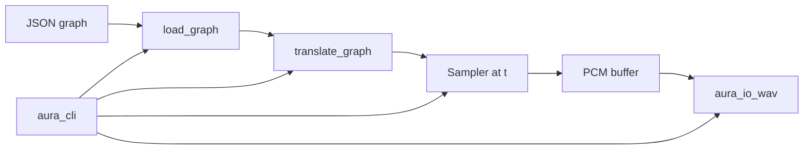

# Architecture

Declarative system requirements for Aura’s crate layout and data flow.

Aura is a **library-first framework**. Surface programs load Imp graphs and render audio via [`aura_integration`](../../crates/aura_integration). See [`notation-synthesis.md`](notation-synthesis.md) and [`imp-execution.md`](imp-execution.md). Motivation: [`../scoping/background.md`](../scoping/background.md).

## High-level components

| Component | Role |
|-----------|------|
| Sequencing | Notation types and musical time (`aura_sequencing`) |
| Composition | Procedural generators (`aura_composition`) |
| Scheduler | Offline timeline and event dispatch (`aura_scheduler`); live CPAL dispatch deferred |
| Synthesizer | Imp node libraries (`aura_imp`) and pure DSP (`aura_dsp`) |
| Integration | Graph translation and sampling (`aura_integration`) |
| Instrumentation | Per-note sampling and mix-down (`aura_instrumentation`) |
| I/O | Offline WAV export (`aura_io_wav`); CPAL playback stub (`aura_io_cpal`, deferred) |

## Crate layout

Organize Rust source as a Cargo workspace of small crates under `crates/`. New features land in the smallest crate that owns the concern. Crate boundaries enforce explicit `Cargo.toml` dependencies; cross-crate APIs are deliberate.

| Crate | Role | Key dependencies |
|-------|------|------------------|
| [`aura_sample`](../../crates/aura_sample) | Sample primitives, sample rate, timing math | DASP |
| [`aura_sequencing`](../../crates/aura_sequencing) | Notation types, musical time | thiserror |
| [`aura_composition`](../../crates/aura_composition) | Procedural generators | aura_sequencing |
| [`aura_scheduler`](../../crates/aura_scheduler) | Offline schedule, lookahead context | aura_sequencing, aura_sample |
| [`aura_instrumentation`](../../crates/aura_instrumentation) | Instruments, per-note render, mix-down | aura_scheduler, aura_dsp, aura_sample |
| [`aura_imp`](../../crates/aura_imp) | Imp node libraries and JSON helpers | imp_core_types, imp_registry |
| [`aura_dsp`](../../crates/aura_dsp) | Pure Time → Sample DSP functions | — |
| [`aura_render`](../../crates/aura_render) | Offline sampling via `Sampler` | aura_dsp, aura_sample |
| [`aura_io_wav`](../../crates/aura_io_wav) | 32-bit float WAV write/read verification | aura_render, aura_sample |
| [`aura_io_cpal`](../../crates/aura_io_cpal) | Real-time playback stub (CPAL bridge) | CPAL, DASP, aura_render |
| [`aura_integration`](../../crates/aura_integration) | Imp graph translation and render glue | aura_imp, composition stack, render, io-wav |
| [`aura_cli`](../../crates/aura_cli) | Thin graph-driven CLI | aura_integration |

Dependency direction flows inward: surface programs → integration → I/O → render → domain crates → sample / dsp → imp.

Per-crate design: [`../crates/`](../crates/).

### Surface integration

An indirect dependency is a hidden direct dependency. Orchestration lives in `aura_integration` and thin surface programs (`aura_cli`, demo scripts), not inside core libraries.

## Audio stack roles

| Library / crate | Role |
|-----------------|------|
| **DASP** (`dasp_sample`, `dasp_signal`) | Sample type traits and signal abstractions; bridges PCM to CPAL formats |
| **CPAL** | Cross-platform real-time audio I/O (deferred in devcontainer) |
| **`aura_dsp`** | Pure `Time → Sample` functions |
| **`aura_io_wav`** | Offline 32-bit float WAV I/O |

Offline and future real-time paths must share the same pure `Sampler::at(t)` functions.

## Data flow

### Imp graph → offline WAV

### Notation in Imp graphs

Music nodes (`arpeggio`, `epic_minor_progression`, `note_at_time`, …) delegate to composition crates at **translate time**. Sample-time evaluation uses precomputed schedule tables — timing remains explicit via the `time` signal. Chord progressions are **data signals** (`chord_progression` port type) composed at translate time and sampleable per frame via `ChordSignal`. Tempo and time signature are separate **data signals** (`tempo`, `time_signature` port types) wired between producer nodes (`constant_tempo`, `constant_time_signature`) and consumers.

### Real-time playback (deferred)

Future CPAL output will call the same `Sampler::at(t)` functions (or block variants) as offline rendering.

## Constraints

- **Real-time audio** — deferred in WSL/devcontainer; file-first WAV is the primary validation path
- **Determinism** — pure `f(t)` sampling; see [`notation-synthesis.md`](notation-synthesis.md)
- **Modularity** — composition, scheduling, instrumentation, and synthesis are separable via crate boundaries

## Non-goals / avoided approaches

- A single monolithic crate for all Aura domains
- FunDSP-style sequential `tick` DSP as the primary synthesis model
- Hiding surface orchestration behind transitive core-crate dependencies

## Open questions

- Buffer/block sampling optimizations without breaking FP semantics
- Graph-owned duration vs external render parameters
- Live scheduler parity with offline lookahead
